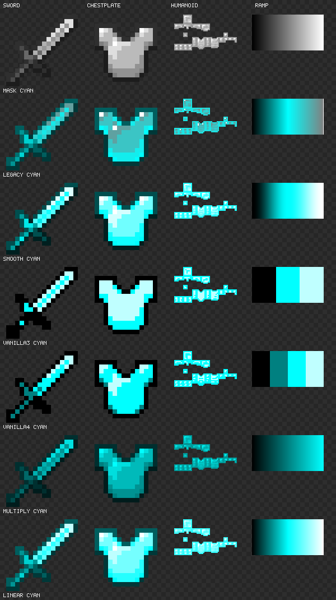
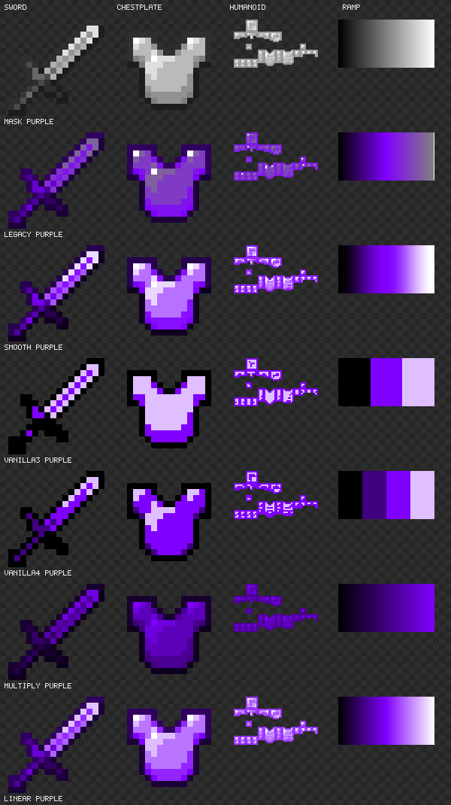
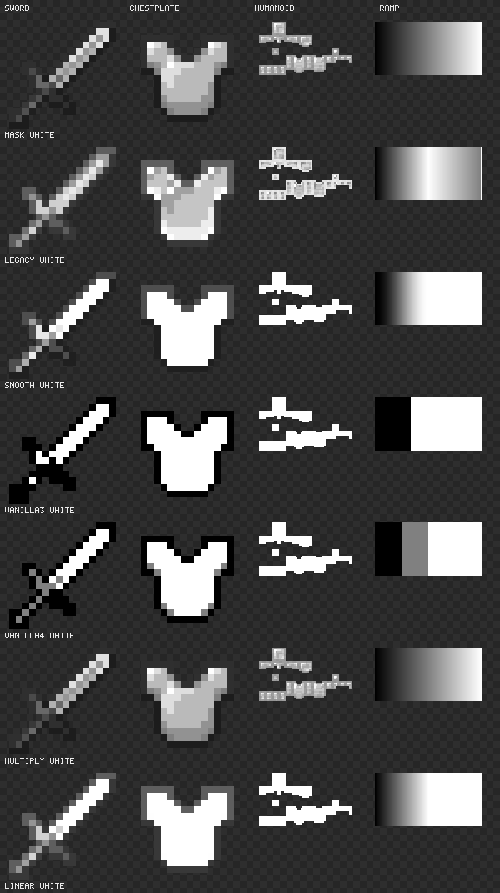
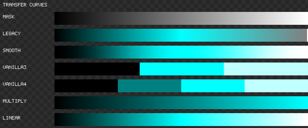
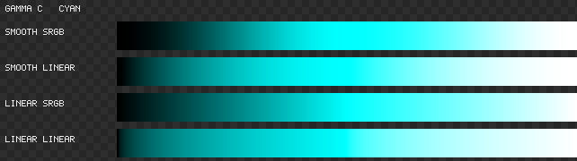

# Grayscale formulas

This document covers the alternative grayscale-to-colour mappings implemented by
`io.mikaple.crythst.client.texture.SmoothGrayscaleColorizer` and
`GrayscaleFormula`. The original `GrayscaleColorizer` and its formula are
unchanged; `GrayscaleFormula.LEGACY` delegates to them and is bit-for-bit
identical.

The goal is to answer a practical question: the original formula is piecewise
and has visible jumps, so can a different mapping produce smoother and/or more
vanilla-Minecraft-looking textures without breaking existing callers?

**Short answer:**

* **Recommended default for vanilla-style equipment and armour:
  `VANILLA_BANDS` with four bands.** It quantizes the mask into black, dark
  primary, primary and a tinted near-white highlight, which is much closer to
  Minecraft's palette-ramp shading than a continuous gradient. Use three bands
  for very small icons or low-contrast masks.
* **Recommended default when the goal is smoothness rather than vanilla
  authenticity: `SMOOTH_RAMP`.** It is C1-continuous and removes both jumps of
  the legacy formula.
* Keep `LEGACY` for compatibility and existing assets.
* Use `MULTIPLY` when the mask is a shading ramp whose brightest authored shade
  is the base colour, not white.
* Use `LINEAR_LIGHT` for a straight, contrastier ramp with a white endpoint.

## 1. Common assumptions

For every formula:

```text
h in [0, 255]      grayscale mask value
H = 255
t = h / H
R                  one channel of the base colour, in [0, 255]
```

Each output RGB channel is computed independently from the matching base-colour
channel. The source alpha is copied through unchanged. The base colour's alpha is
ignored. Pixels are treated as **straight (non-premultiplied) alpha**; nothing is
premultiplied or divided by alpha.

The intended reading of the mask is:

| mask | meaning |
| --- | --- |
| `h = 0` | darkest shade |
| `h ≈ 127.5` | base / primary colour |
| `h = 255` | brightest shade |

## 2. The formulas

### 2.1 `LEGACY` — the original formula, unchanged

```text
f_legacy(R, h) = (1 - |2h/H - 1|) * R + floor(2h/H) * (h - H/2)
```

Piecewise for integer `h`:

| `h` | result |
| --- | --- |
| `0..127` | `(2h/255) * R` |
| `128..254` | `(2 - 2h/255) * R + (h - 127.5)` |
| `255` | `255`, because `floor(2) = 2` |

This is the user's formula and is preserved exactly, including the `+0.5` jump
at `h = 127/128` and the large jump at `h = 254/255`. It is also non-monotonic
in the upper half: for a base channel `R = 255`, the output falls from `255` at
`h = 128` to `129` at `h = 254`, then jumps back to `255` at `h = 255`.

`SmoothGrayscaleColorizer.tintChannel(..., LEGACY, ...)` calls
`GrayscaleColorizer.tintChannel` directly, so there is no second implementation
to drift.

### 2.2 `SMOOTH_RAMP` — C1-continuous smoothstep ramp

Define the cubic smoothstep

```text
S(u) = u^2 * (3 - 2u),   0 <= u <= 1
S'(u) = 6u(1 - u)
```

Then

```text
f_smooth(R, h) = S(2t) * R                       for t <= 1/2
               = R + S(2t - 1) * (255 - R)       for t >  1/2
```

Properties:

* `f_smooth(R, 0) = 0` — black.
* `f_smooth(R, 255) = 255` — white, for every `R`.
* `f_smooth(R, 127) = f_smooth(R, 128) = R` — the base colour, with no middle
  jump.
* `S'(0) = S'(1) = 0`; both halves therefore have zero derivative at the join,
  so the ramp is C1 at `h = 127.5`. The endpoints are flat too.
* The ramp is monotonic. The largest output step between adjacent integer mask
  values is 3 levels in sRGB space (5 in linear-sRGB blending, including
  rounding), versus jumps of up to 128 levels for `LEGACY` near white.

For `R = 255` the upper half is constant white. That is deliberate: the base
colour is already the brightest possible value, so there is nothing left to
raise toward white.

### 2.3 `VANILLA_BANDS` — quantized palette ramp

Vanilla armour and equipment are usually palette swaps: a small palette of flat
shade tones (`PalettedPermutations`, trim palettes), not a smooth analytic
gradient. This formula reproduces that character.

For `n` bands:

```text
band = min(n - 1, floor(h * n / 256))
```

The division uses `256`, not `255`, so the last band contains `h = 255` and the
bands are equal width. With the default `n = 4`:

| band | `h` range | output |
| --- | --- | --- |
| 0 | `0..63` | black (`0`) |
| 1 | `64..127` | dark primary (`0.5 * R`) |
| 2 | `128..191` | primary (`R`) |
| 3 | `192..255` | highlight (`R + 0.75 * (255 - R)`) |

With `n = 3`:

| band | `h` range | output |
| --- | --- | --- |
| 0 | `0..85` | black |
| 1 | `86..170` | primary |
| 2 | `171..255` | highlight |

Band counts from 3 to 8 are accepted. For `n >= 4`, the middle bands step from
`0.5R` to `R`; for example, `n = 5` uses `0.5R`, `0.75R`, `R`. The top band is
always a 75% mix toward white, so it retains the hue of the primary instead of
turning into flat white. A pure white primary yields a pure white highlight.

Why a tinted highlight instead of pure white? Vanilla's brightest shade is
usually a very light tint of the material colour (light blue for diamond, pale
gold for gold), not neutral white. The 75% mix is a compromise: near-white, but
still recognisably cyan, purple, etc. If a flat pure-white top band is wanted,
use a white primary or change `VANILLA_HIGHLIGHT_MIX`.

The four-band mapping is the recommended default for 16×16 item icons and armour
layers. The three-band mapping is better when the mask has few distinct levels or
the icon is very small; the black band can otherwise swallow too much detail.
On a noisy or anti-aliased mask, quantization is visible by design; use
`SMOOTH_RAMP` there instead.

### 2.4 `MULTIPLY` — hue-preserving armour shading

```text
f_multiply(R, h) = round(R * t)
```

`h = 0` is black and `h = 255` is exactly the base colour. There is no white
highlight. This is useful when the grayscale image is already a shading ramp
(dark crevices to lit surfaces) and the primary is the lit colour. Hue is
preserved exactly because every channel is scaled by the same factor. If the
primary is light, the result is naturally near-white at full mask value.

This is the best choice for "tint the armour but keep the authored shading"
workflows, where adding a white top band would wash out the material colour.

### 2.5 `LINEAR_LIGHT` — straight ramp with an additive white highlight

```text
f_linear_light(R, h) = 2t * R                       for t <= 1/2
                     = R + (2t - 1) * (255 - R)     for t >  1/2
```

This is `MULTIPLY` on the lower half, followed by an additive white highlight on
the upper half. It reaches white at `h = 255`, has no floor jump, and keeps more
contrast than the smoothstep ramp. The cost is a slope change at the base colour
(C0, not C1), which is usually invisible in a small texture but can matter for
large gradients.

`LINEAR_LIGHT` is closer to the original formula's shape than `SMOOTH_RAMP`
(especially around `h = 128`) while still removing the discontinuity at
`h = 254/255`.

## 3. Sample values

The table below shows the RGB output for cyan (`#00FFFF`) at representative mask
values. The comparison sheets contain the same rows for purple and white.

| `h` | `LEGACY` | `SMOOTH_RAMP` | `VANILLA3` | `VANILLA4` | `MULTIPLY` | `LINEAR_LIGHT` |
| --- | --- | --- | --- | --- | --- | --- |
| `0` | `0,0,0` | `0,0,0` | `0,0,0` | `0,0,0` | `0,0,0` | `0,0,0` |
| `64` | `0,128,128` | `0,128,128` | `0,0,0` | `0,128,128` | `0,64,64` | `0,128,128` |
| `127` | `0,254,254` | `0,255,255` | `0,255,255` | `0,128,128` | `0,127,127` | `0,254,254` |
| `128` | `1,255,255` | `0,255,255` | `0,255,255` | `0,255,255` | `0,128,128` | `1,255,255` |
| `192` | `65,191,191` | `130,255,255` | `191,255,255` | `191,255,255` | `0,192,192` | `129,255,255` |
| `255` | `255,255,255` | `255,255,255` | `191,255,255` | `191,255,255` | `0,255,255` | `255,255,255` |

### Visual comparison

Cyan, `sword` / `chestplate` / `humanoid` masks plus a transfer ramp:



Purple:



White primary (the top vanilla band becomes pure white):



The transfer curves make the discontinuities easier to see. `LEGACY` has a small
step near the middle and a large step at the far right; `SMOOTH_RAMP` is a clean
S-curve; the vanilla rows are flat bands:



Gamma comparison for the two continuous formulas (cyan-to-white ramp, sRGB vs
linear-space blending):



## 4. Gamma-aware blending

`SmoothGrayscaleColorizer.BlendSpace` selects how interpolation toward black or
white is performed:

* `SRGB` (default) blends the stored 8-bit sRGB values directly.
* `LINEAR` decodes both endpoints with the standard IEC 61966-2-1 sRGB transfer
  function, blends in linear light, then re-encodes to 8-bit sRGB.

The helper functions are:

```text
decode(c) = c / 12.92                                if c <= 0.04045
          = ((c + 0.055) / 1.055)^2.4                otherwise

encode(x) = 12.92 * x                                if x <= 0.0031308
          = 1.055 * x^(1/2.4) - 0.055                otherwise
```

where `c = channel / 255` and `x` is linear light. Endpoints and the base colour
are unchanged; midtones become lighter (for example, `R = 128` at `h = 64`
becomes `93` in linear space instead of `64` in sRGB space).

Gamma-aware blending is applied only to `SMOOTH_RAMP` and `LINEAR_LIGHT`. The
legacy formula, the quantized vanilla bands and the multiply formula are defined
in 8-bit sRGB space and ignore the blend space. This is intentional:

* `LEGACY` must stay bit-exact.
* Vanilla palettes are authored as concrete 8-bit colours; linearising them
  would change the palette and stop matching vanilla's look.
* `MULTIPLY` is a direct channel scale, not a blend between two colours.

Use `LINEAR` for physically correct compositing of glows, fades or large smooth
gradients. Use `SRGB` when matching authored palette values and existing assets.
It is optional: the default reproduces the simple, predictable 8-bit result.

## 5. Choosing a formula

| goal | formula | notes |
| --- | --- | --- |
| Existing textures and compatibility | `LEGACY` | Exact old values; keeps the 127/128 and 254/255 jumps. |
| Vanilla-style armour/equipment | `VANILLA_BANDS`, 4 bands | Recommended default for a vanilla look. Tinted near-white top band. |
| Very small or low-contrast icons | `VANILLA_BANDS`, 3 bands | Less band loss than four bands. |
| Smooth gradients, glows, entity skins | `SMOOTH_RAMP` | C1, monotonic, no jumps. |
| Tint authored shading without white | `MULTIPLY` | Preserves hue; `h = 255` is the base colour. |
| Contrasty ramp with white endpoint | `LINEAR_LIGHT` | C0 at the base colour, but no floor jump. |

A practical rule:

1. If the source textures already look like vanilla palette art (a handful of
   flat tones), use `VANILLA_BANDS` with four bands.
2. If the source is a photographic or anti-aliased gradient, use `SMOOTH_RAMP`.
3. If the source is a shading mask and white highlights look wrong, use
   `MULTIPLY`.
4. Only use `LEGACY` when compatibility with the old output is required.

## 6. API examples

One channel:

```java
int red = SmoothGrayscaleColorizer.tintChannel(
        baseRed, mask, GrayscaleFormula.SMOOTH_RAMP);

int vanillaRed = SmoothGrayscaleColorizer.tintChannel(
        baseRed, mask, GrayscaleFormula.VANILLA_BANDS, 4);
```

One pixel:

```java
int tinted = SmoothGrayscaleColorizer.tintArgb(
        sourceArgb, 0xFF00FFFF, GrayscaleFormula.VANILLA_BANDS);
```

A whole image:

```java
int[] tinted = SmoothGrayscaleColorizer.tint(
        sourcePixels, 0xFF8000FF, GrayscaleFormula.SMOOTH_RAMP);
```

With an outline colour:

```java
int[] tinted = SmoothGrayscaleColorizer.tintWithOutline(
        sourcePixels, width, height,
        primaryColor, outlineColor,
        GrayscaleFormula.SMOOTH_RAMP,
        OutlineMask.Mode.FOUR_NEIGHBOURS);
```

With gamma-aware blending and an explicit band count:

```java
int[] tinted = SmoothGrayscaleColorizer.tint(
        sourcePixels, 0xFF00FFFF,
        GrayscaleFormula.SMOOTH_RAMP, 4,
        SmoothGrayscaleColorizer.BlendSpace.LINEAR);
```

All `tint` and `tintWithOutline` overloads allocate a new array and do not
mutate their input. Fully transparent pixels are copied byte-for-byte by the
outline overloads.

## 7. Tests and generated assets

Tests:

* `SmoothGrayscaleColorizerTest` covers endpoints, the base-colour midpoint,
  legacy exactness, monotonicity, adjacent-step continuity, band boundaries,
  configurable band counts, alpha preservation, non-mutation, the outline pass,
  and gamma-aware blending.
* `SmoothGrayscaleColorizerAssetsTest` loads every generated PNG and compares it
  with the Java formula, so the Python asset generator and the Java
  implementation cannot drift apart.

Asset generator:

```bash
python3 tools/grayscale_formula_assets.py
```

It reads the checked-in masks in `textures/test/grayscale/` and writes to
`textures/test/color_smooth/`:

* three masks (`sword`, `chestplate`, `humanoid`);
* three colours (`cyan`, `purple`, `white`);
* six formula variants (`legacy`, `smooth`, `vanilla3`, `vanilla4`, `multiply`,
  `linear_light`);
* per-colour comparison sheets, `transfer_curves.png` and
  `gamma_comparison.png`.

The assets are deliberately generated from the existing grayscale masks rather
than from the Minecraft jar, so the tool runs without a game installation.

## 8. Relationship to vanilla palettes

Vanilla's equipment textures, trims and armour layers commonly use
`PalettedPermutations` or hard-coded palette ramps: an indexed image is remapped
to a short list of material colours. That is why they read as a few flat shade
bands rather than a continuous gradient.

`VANILLA_BANDS` is the closest match in this package. It is still a scalar
mapping, not a true palette swap: it cannot know that two different mask values
belong to two different authored palette entries. For exact vanilla palette
matching, a real indexed-palette path is still preferable. For generated or
grayscale-derived equipment, `VANILLA_BANDS` gives the same visual language with
much less machinery.

The original formula remains available and unchanged for callers that need its
exact output.
